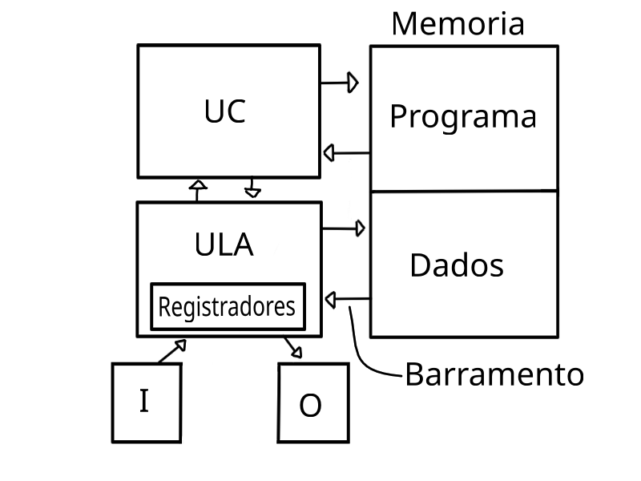

# Arquitetura e Organização de Computadores

Para compreender a estrutura e o funcionamento dos computadores modernos, devemos analisar vários fatores, desde aspectos gerais, como o conceito de arquitetura de computadores, até a implementação prática desses modelos, além das características internas dos componentes. Para estabelecer os conceitos a serem compreendidos, pode-se aplicar a seguinte distinção:

- **Arquitetura:** Refere-se aos modelos conceituais (Von Neumann e Harvard), aos modelos de instruções da CPU (CISC e RISC) ou aos conjuntos de instruções (ISA) implementados (x86 e ARM).
- **Organização:** Refere-se à implementação prática desses modelos, considerando os dispositivos utilizados (placa-mãe, CPU e memória), seus barramentos (controle, dados e endereço), os dispositivos de I/O (teclado e monitor) e a tecnologia empregada (RAM).

## Modelos de Arquitetura Conceitual

Os modelos de arquitetura conceitual representam os princípios fundamentais de funcionamento de um computador, definindo como suas unidades funcionais se relacionam e como ocorre o fluxo de informações entre elas. Esses modelos não descrevem necessariamente a implementação física dos componentes, mas servem como referência para compreender a estrutura e o funcionamento dos sistemas computacionais.

### Arquitetura Von Neumann (1940)

Criada por volta de 1940 por John von Neumann, tornou-se o modelo-base dos computadores modernos. Baseia-se no conceito de programa armazenado, que define que programas e dados são armazenados em uma memória compartilhada. Esse modelo conta com cinco componentes básicos:

- **Unidade de Controle (UC):** Responsável por gerenciar os recursos do computador e coordenar o funcionamento de suas partes.
- **Unidade Lógica e Aritmética (ULA):** Executa as operações solicitadas pela UC, como operações matemáticas e lógicas.
- **Memória Principal:** Armazena tanto os dados quanto as instruções dos programas em execução, fornecendo-os quando necessário.
- **Unidades de Entrada e Saída (I/O):** Gerenciam a transferência de dados entre o computador e os periféricos externos, como teclados (Input) e monitores (Output).
- **Estrutura de Interconexão:** Conjunto de caminhos, como o **barramento do sistema**, dividido em linhas de dados, de endereço e de controle, destinadas à transferência de dados entre os componentes.

*Modelo Conceitual Von Neumann*

**Ciclo de execução de Von Neumann**

O ciclo de execução de uma máquina de Von Neumann é composto por três etapas:

1. **Busca:** Realiza a busca da instrução na memória.
2. **Decodificação:** Interpreta a instrução recebida, identificando a operação a ser realizada e os dados ou registradores necessários para sua execução.
3. **Execução:** Executa as instruções determinadas.

**O Gargalo de Von Neumann**

Refere-se à limitação na taxa de transferência de informações entre o processador e a memória. Como existe apenas um caminho (barramento) compartilhado para a transferência de instruções e dados, essas operações disputam o mesmo meio de comunicação, podendo fazer com que o processador precise aguardar a transferência das informações necessárias para continuar sua execução.

### Arquitetura Harvard
