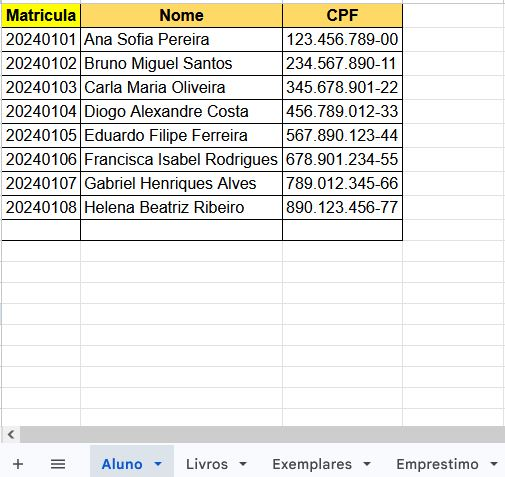
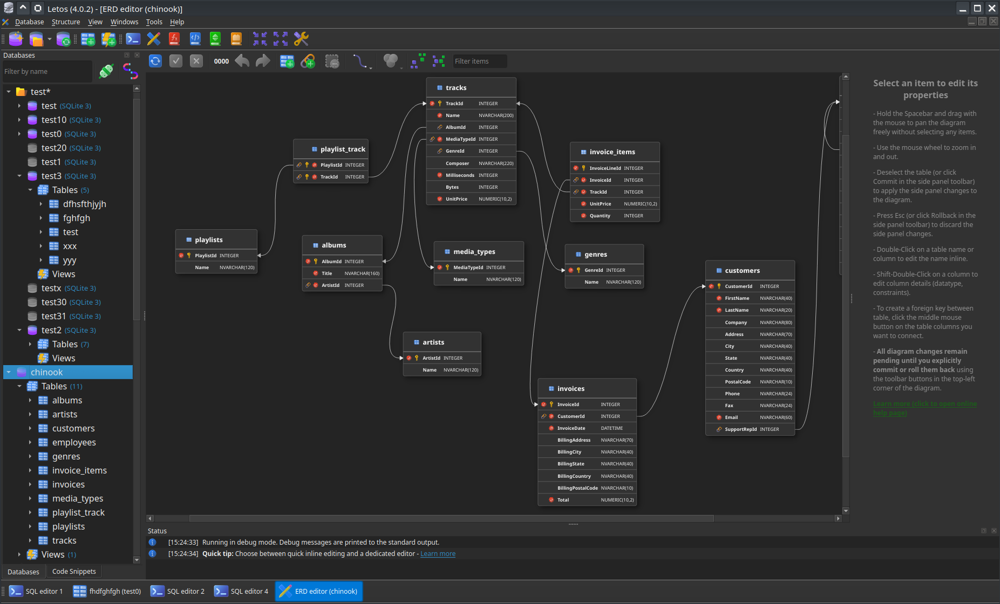
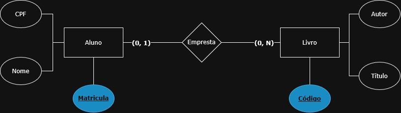
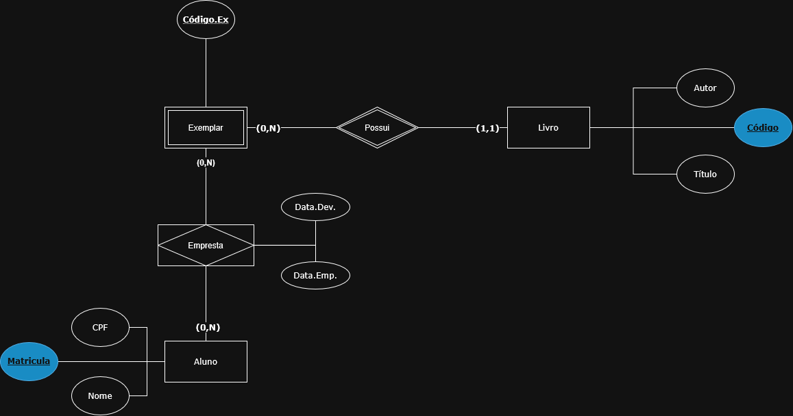
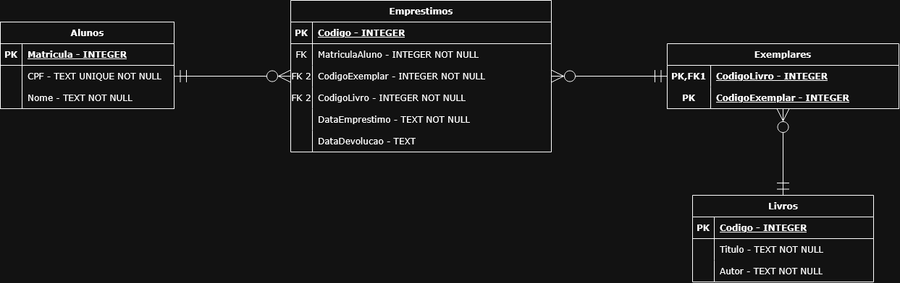

# Bancos de Dados

Um banco de dados (do inglês *database*) é uma coleção organizada de dados relacionados entre si, guardada em tabelas ou documentos, preparada para ser consultada e atualizada com facilidade.

Quase toda organização utiliza bancos de dados:

- **Comércio Eletrônico:** Registro de catálogos de produtos, clientes, carrinhos de compras e histórico de encomendas.
- **Bancos e Finanças:** Gestão de contas, saldo, histórico de transações e transferências bancárias.
- **Saúde:** Prontuários médicos de pacientes, consultas agendadas e receituário.
- **Educação:** Matrículas de estudantes, pautas de notas, histórico escolar e frequência.

Nota-se que há uma distinção importante entre dados e informações:
- Um dado é um valor isolado, sem contexto, não tendo significado para o leitor. Ex: 4002-8922, sem nenhuma referência.
- Uma informação é um dado com significado e contexto, permitindo leitura e interpretação. Ex: Telefone - 4002-8922. Nesse caso, sabemos ao que se refere.

Uma forma muito comum de armazenar e organizar dados é por meio de planilhas. Elas fornecem um meio simples de estruturar informações em linhas e colunas, sendo bastante práticas no dia a dia de diversas instituições. Apesar de sua utilidade, o uso de bancos de dados evita diversos problemas, como:

- **Dados repetidos:** o mesmo cliente é digitado em várias planilhas.
- **Dados divergentes:** o cliente muda de telefone e só uma das cópias é atualizada.
- **Acesso simultâneo:** duas pessoas editando o mesmo arquivo podem sobrescrever o trabalho uma da outra.
- **Falta de controle de acesso:** quem abre o arquivo vê e altera tudo.



## Sistemas de Gerenciamento de Bancos de Dados (SGBDs)

Os SGBDs são softwares responsáveis por criar e gerenciar bancos de dados, trazendo funções capazes de sanar esses problemas. Eles oferecem diversos mecanismos úteis para a administração de DBs, como:

- **Controle de Acesso e Segurança:** Define permissões de usuários, restringindo quem pode visualizar, inserir, alterar ou remover dados.
- **Controle de Integridade:** Valida os dados inseridos de acordo com regras de negócio e restrições estruturais (ex.: chaves primárias, campos obrigatórios).
- **Gerenciamento de Concorrência:** Permite que múltiplos usuários ou aplicações acessem e modifiquem a base de dados simultaneamente sem gerar conflitos ou perda de dados.
- **Recuperação e Backup:** Mantém registros de transações (logs) para restaurar o estado consistente da base de dados em caso de falhas elétricas, de hardware ou de software.
- **Interface de Comunicação:** Permite integração com ferramentas gráficas para manipular o banco de dados sem necessidade de código, além da integração padrão com a linguagem SQL.

Em suma, o principal objetivo de um SGBD é criar uma camada de abstração: ele esconde a complexidade de como os arquivos são salvos no disco rígido e entrega para o desenvolvedor e para o usuário uma forma simples e visual de manipular as informações.

### Tipos de Bancos de Dados

Os dois modelos mais comuns de banco de dados são:
- **Bancos de Dados Relacionais (SQL):** São DBs que organizam dados na forma de linhas e colunas, gerando tabelas que se conectam entre si.
- **Bancos de Dados Não Relacionais (NoSQL):** São DBs que podem ser organizados de diversas formas, como documentos.

Os SGBDs mais comuns são:
- MySQL (SQL)
- SQLite (SQL)
- MongoDB (NoSQL)
- Redis (NoSQL)



## Modelagem de Bancos de Dados Relacionais

A modelagem de banco de dados é o processo de planejar e estruturar como as informações de um sistema serão salvas. Ela transforma as necessidades do negócio em um projeto claro e organizado, proporcionando uma visão detalhada da estrutura do banco de dados. Essa estruturação acontece em quatro etapas progressivas:

1. **Análise de Requisitos:** Levantamento das necessidades e regras do negócio para gerar a documentação inicial do sistema.
2. **Modelagem Conceitual:** Mapeamento de alto nível das entidades e seus relacionamentos utilizando o MER e o DER, de forma independente de tecnologia.
3. **Projeto Lógico:** Estruturação das informações no paradigma relacional, definindo tabelas, colunas, tipos de dados e chaves através do Esquema Relacional.
4. **Projeto Físico e Implementação:** Tradução do modelo relacional em código SQL concreto diretamente no SGBD escolhido para gerar a base de dados funcional.

### Modelo Entidade-Relacionamento (MER)

O **Modelo Entidade-Relacionamento (MER)** é um modelo conceitual de alto nível que representa o mundo real por meio de três componentes:

1. **Entidade:** Representa um objeto, pessoa ou conceito do mundo real sobre o qual se deseja guardar informações (ex.: `ALUNO`, `LIVRO`, `PROFESSOR`).
2. **Atributo:** Característica ou propriedade que descreve uma entidade (ex.: `nome`, `cpf`, `data_nascimento`). É necessário destacar um atributo que sirva como identificador único para a entidade.
3. **Relacionamento:** Associação entre duas ou mais entidades, descrita por um verbo (ex.: `ALUNO` *empresta* `LIVRO`).

**Exemplo de MER**

> **1. Entidades e Atributos:**
> - **Aluno:** Representa os estudantes cadastrados na biblioteca.
>   - *Atributos:* Matrícula (identificador principal), Nome e CPF.
> - **Livro:** Representa os exemplares presentes na biblioteca.
>   - *Atributos:* Código (identificador principal), Título e Autor.
>
> **2. Relacionamentos:**
> - **Empresta:** Conecta a entidade "Aluno" à entidade "Livro".
>   - *Atributos do Relacionamento:* DataEmpréstimo, DataDevolução.
>
> **3. Regras de Negócio:**
> - **Aluno:** Um aluno pode estar cadastrado sem possuir livros emprestados no momento, mas pode realizar o empréstimo de múltiplos livros simultaneamente.
> - **Livro:** Um exemplar de livro pode estar guardado (sem nenhum empréstimo ativo) ou emprestado para no máximo um único aluno por vez.

### Diagrama Entidade-Relacionamento (DER)

É a representação gráfica e visual do MER utilizando símbolos padronizados. Alguns deles são:

- **Retângulo:** Representa as entidades.
- **Elipse/Círculo:** Representa os atributos das entidades e dos relacionamentos. O atributo que for o identificador único é escrito com algum destaque, como sublinhado ou cor diferente.
- **Losango:** Representa os relacionamentos entre as entidades.
- **Linha:** Conecta os elementos do diagrama (liga atributos às entidades/relacionamentos e entidades aos relacionamentos).

#### Cardinalidade

A cardinalidade é uma extensão do DER e indica os limites mínimo e máximo de ocorrências de uma entidade associadas a outra. Ou seja, ela define quantas instâncias de uma entidade se relacionam com a outra.

A notação de cardinalidade mais usada é o modelo Min/Max, que indica explicitamente quantas ocorrências de uma entidade podem participar de um relacionamento. Essa representação é feita escrevendo, entre parênteses, os valores mínimo e máximo da relação. Esses valores podem ser:

| Par (Min, Max) | Participação | Significado |
| :---: | :--- | :--- |
| **(0,1)** | Opcional | Mínimo 0, máximo 1 vez. |
| **(1,1)** | Obrigatória | Exatamente 1 vez. |
| **(0,n)** | Opcional | Mínimo 0, máximo várias vezes (N). |
| **(1,n)** | Obrigatória | Mínimo 1, máximo várias vezes (N). |

A notação é escrita junto à entidade referente à regra. Por exemplo, segundo nossa regra de negócio para Aluno:

>**Aluno:** Um aluno pode estar cadastrado sem possuir livros emprestados no momento, mas pode realizar o empréstimo de múltiplos livros simultaneamente.

De acordo com essa regra, podemos notar que o valor (min, max) dessa relação é de no mínimo 0 e no máximo N (um número indeterminado) de livros, resultando em **(0, n)**.

Fazendo o mesmo com a regra de negócio para Livro:

>**Livro:** Um exemplar de livro pode estar guardado (sem nenhum empréstimo ativo) ou emprestado para no máximo um único aluno por vez.

De acordo com essa regra, podemos notar que o valor (min, max) dessa relação é de no mínimo 0 e no máximo 1 aluno, resultando em **(0, 1)**.



### Tipos de Entidades

Existem vários tipos de entidades, que podem ser classificadas de acordo com sua autonomia no sistema:

1. **Entidade Forte:** É uma entidade cuja existência não depende de nenhuma outra entidade do sistema, possuindo um atributo identificador próprio.
   - Exemplo: `Aluno` (identificado pela `Matrícula`), `Livro` (identificado pelo `Código`).

2. **Entidade Fraca:** É uma entidade cuja existência depende diretamente de uma entidade forte. Ela não possui um identificador próprio, necessitando do identificador da entidade forte somado a um atributo parcial para ser identificada.
   - Exemplo: A entidade `Exemplar`, que representa a cópia física e deve, obrigatoriamente, estar associada a um `Livro`.
   - Atributos no MER: Apenas o discriminador `CódigoExemplar` (o código do livro é herdado automaticamente pelo relacionamento identificador).
   - Representação no DER: Retângulo duplo (para a entidade) e Losango duplo (para o relacionamento identificador).
   - Regra de Negócio e Cardinalidade: Um livro pode não ter nenhum exemplar cadastrado, mas pode ter vários `(0,N)`. Um exemplar deve pertencer obrigatoriamente a um único livro `(1,1)`.

3. **Entidade Associativa:** Surge quando um relacionamento (especialmente do tipo Muitos para Muitos - N:M) possui atributos próprios da transação e precisa registrar um histórico de ocorrências ao longo do tempo.
   - Exemplo: A ação `Empresta` armazena dados próprios do evento, como `DataEmpréstimo` e `DataDevolução`.
   - Conexão Correta: O empréstimo deve ser conectado ao `Exemplar` (item físico) e ao `Aluno`, permitindo saber exatamente qual cópia física está com qual estudante.
   - Regra de Negócio e Cardinalidade: Um aluno pode realizar nenhum ou vários empréstimos ao longo do tempo `(0,n)`. Um exemplar pode ser emprestado várias vezes ao longo de sua vida útil `(0,n)`.

### Como Identificar Entidades

Para decidir se algo deve ser mapeado como Entidade, Atributo ou Relacionamento, use estas três regras:

1. É um substantivo ou objeto que existe por si só? Faz sentido existir no sistema mesmo que não realize nenhuma ação no momento? Se sim, é uma **Entidade Forte** (ex: `Aluno`, `Livro`, `Editora`).
2. É uma característica isolada que não faz sentido existir sozinha? Uma data, nome ou valor soltos no vácuo fazem sentido sem estar ligados a alguém? Se não, vira um **Atributo** (ex: `Nome`, `DataNascimento`, `Preço`).
3. É uma ação ou evento que acontece várias vezes e precisa guardar histórico? Essa ação precisa registrar quando aconteceu, qual o status ou a data de devolução ao longo do tempo? Se sim, a ação deixa de ser um simples vínculo e vira uma **Entidade Associativa** (ex: `Empréstimo`, `Venda`, `Matrícula`).



### Modelo Lógico Relacional

O Modelo Lógico traduz os requisitos do negócio (MER/DER) para a estrutura real de um banco de dados relacional. É aqui que os dados ganham forma por meio de tabelas, colunas e chaves, garantindo a organização e a integridade das informações.

#### Chaves

No contexto de bancos de dados relacionais, chaves são atributos (colunas) usados para identificar registros de forma única e estabelecer relacionamentos entre tabelas. Elas são o pilar do modelo relacional, pois garantem a integridade, a unicidade e a consistência dos dados, impedindo registros duplicados e referências inválidas.

Existem diversos tipos de chaves, cada uma com um propósito específico. Seguem alguns exemplos:

- **Chave Candidata:** Qualquer atributo que possui a capacidade de identificar unicamente uma linha da tabela.
  - *Exemplo:* Na tabela `Aluno`, tanto o `CPF` quanto a `Matrícula` são chaves candidatas.
- **Chave Primária (PK - Primary Key):** É a chave candidata escolhida para ser o identificador principal da tabela. Possui duas regras fundamentais: não pode conter valores nulos e deve conter apenas valores únicos.
  - *Exemplo:* A `Matrícula` escolhida para identificar unicamente o `Aluno`.
- **Chave Alternativa:** Qualquer chave candidata que não foi escolhida como a chave primária.
  - *Exemplo:* O `CPF` do aluno (continua sendo único, mas não é a chave principal).
- **Chave Estrangeira (FK - Foreign Key):** Coluna que referencia a Chave Primária de outra tabela. É ela quem estabelece e mantém o relacionamento e a integridade referencial entre duas tabelas.

#### Regras de Mapeamento

Para mapear o Modelo Conceitual para o Modelo Lógico Relacional, seguimos estas regras:

1. **Entidades:** Cada entidade vira uma tabela. O Atributo Identificador do MER vira a Chave Primária (PK) da tabela.
2. **Atributos:** Viram colunas na respectiva tabela.
3. **Relacionamento (1:N) (Um para Muitos):**
   - Não cria uma nova tabela.
   - Copia-se a Chave Primária (PK) da tabela do lado 1 para a tabela do lado N, onde passa a atuar como Chave Estrangeira (FK).
4. **Relacionamento (N:M) (Muitos para Muitos):**
   - **OBRIGATORIAMENTE cria uma nova tabela intermediária**.
   - Esta tabela herda as PKs das duas entidades envolvidas, que juntas formam uma Chave Primária Composta, e ambas atuam individualmente como FKs.
   - Quaisquer atributos pertencentes ao relacionamento N:M viram colunas nesta nova tabela.
5. **Relacionamento (1:1):** Adiciona-se a FK na tabela do lado onde a participação no relacionamento for obrigatória.

#### Símbolos do Diagrama Lógico Relacional

Enquanto o DER conceitual (modelo de Chen) utiliza formas geométricas abstratas (retângulos, losangos e elipses), o Diagrama Lógico Relacional (ou Diagrama ER Lógico) representa a estrutura física próxima do banco de dados real. Os principais elementos visuais são:

- *Tabelas (Entidades Relacionais):* Retângulos divididos em duas seções: o cabeçalho com o nome da tabela e o corpo com a lista de colunas.
- *Colunas e Tipos de Dados:* Cada linha da tabela indica o nome do atributo e seu tipo de dado correspondente (ex.: `id INTEGER`, `nome VARCHAR(100)`).
- *Marcadores de Chaves:*
    - *PK (Primary Key):* Identifica a chave primária da tabela
    - *FK (Foreign Key):* Identifica a chave estrangeira que aponta para a PK de outra tabela.
    - *PK/FK (Primary Foreign Key):* Utilizada em tabelas associativas/fracas onde a FK também compõe a chave primária.

#### Cardinalidade no Modelo Relacional

No Modelo Relacional, a cardinalidade estabelece os limites de registros associados entre duas tabelas por meio das chaves estrangeiras (*FK*).

Na prática relacional:

1. *Relacionamentos N:M não existem diretamente:* São obrigatoriamente decompostos em duas relações `1:N` através de uma *tabela intermediária (associativa)*.
2. *A Chave Estrangeira (FK) fica sempre no lado N:* A tabela do lado "Muitos" armazena a chave primária da tabela do lado "Um".

#### Notação Pé de Galinha (Crow's Foot)
A Notação Pé de Galinha (Crow's Foot) é o padrão visual mais utilizado em ferramentas de modelagem relacional. Ela representa a multiplicidade (máximo) e a opcionalidade (mínimo) nas extremidades das linhas de conexão.

Cada extremidade possui dois símbolos adjacentes:
- *Símbolo Interno (junto à tabela):* Define a multiplicidade máxima (`Um` ou `Muitos`).
- *Símbolo Externo (mais distante da tabela):* Define a participação mínima (Obrigatória `1`ou Opcional `0`).

*Regras Práticas de Leitura:*
- O "pé de galinha" (`{`) fica sempre posicionado na tabela filha (a tabela que recebe a `FK`).
- A extremidade próxima à tabela Pai indica quantos registros pais uma linha da tabela filha pode ter (normalmente `1,1` ou `0,1`).
- A extremidade próxima à tabela Filha indica quantos registros filhos uma linha da tabela pai pode possuir (`0,N` ou `1,N`).



## Normalização de bancos de dados

A normalização de bancos de dados relacionais foi introduzida por Edgar F. Codd com o objetivo de eliminar redundâncias desnecessárias e prevenir anomalias no processo de CRUD. As formas normais são aplicadas de maneira sequencial e cumulativa: para que uma tabela atinja uma determinada forma normal, ela deve obrigatoriamente satisfazer todos os requisitos das formas anteriores.

Estruturas inadequadas podem gerar problemas como:
- **Anomalia de inserção:** Ocorre quando não é possível registrar determinada informação sem fornecer outra que não deveria ser necessária.
    - *Ex.: Não conseguir cadastrar um novo livro na biblioteca sem informar um aluno que o tenha emprestado.*
- **Anomalia de atualização:** Ocorre quando uma mesma informação aparece em múltiplos registros e precisa ser alterada em todos eles para manter a consistência.
    - *Ex.: O nome de um aluno aparece em vários registros de empréstimos. Caso seja corrigido, será necessário atualizar todos eles para evitar informações divergentes.*
- **Anomalia de exclusão:** Ocorre quando a remoção de um registro provoca a perda indesejada de outras informações.
    - *Ex.: Ao excluir o único registro de empréstimo de determinado livro, suas informações cadastrais também são perdidas, mesmo que o livro continue pertencendo à biblioteca.*

### Primeira Forma Normal (FN1)

### Segunda Forma Normal (FN2)

### Terceira Forma Normal (FN3)


## SQL

### Tipos de dados

Em um banco de dados, cada coluna de uma tabela é associada a um tipo de dado que define quais valores ela pode receber. Criamos restrições de dados por alguns motivos, como:

- **Integridade e Validação:** Dados que são de tipos diferentes dos definidos para a coluna são impedidos de ser armazenados.
- **Interpretação e Operações:** Definem como o SGBD trata valores em consultas e cálculos — por exemplo, somar numericamente valores do tipo `INTEGER`/`REAL` versus concatenar textos do tipo `TEXT`.

O SGBD SQLite3 adota o conceito de Afinidade de Tipos (*Type Affinity*), onde o tipo se liga ao valor armazenado e não apenas à coluna.

A Type Affinity no SQLite3 é a preferência flexível de tipo atribuída a uma coluna na criação da tabela. Em vez de bloquear a inserção com regras rígidas de tipo, a coluna apenas tenta converter o valor recebido para o seu tipo preferencial (`INTEGER`, `REAL`, `TEXT`, `NUMERIC` ou `BLOB`); se a conversão não for possível sem perda de dados, o SQLite armazena o valor na sua forma original sem lançar erros.

| Tipo de Dado | Descrição | Exemplo Prático |
| :--- | :--- | :--- |
| **`INTEGER`** | Números inteiros (positivos ou negativos, sem casas decimais). | `10`, `-450`, `2026` |
| **`REAL`** | Números reais de ponto flutuante (com casas decimais). | `3.14159`, `99.90` |
| **`TEXT`** | Cadeias de caracteres (strings de texto) em UTF-8 ou UTF-16. | `'Maria Silva'`, `'São Paulo'` |
| **`BLOB`** | *Binary Large Object*: dados binários puros mantidos exatamente como inseridos. | Fotos, arquivos PDF, áudios |
| **`NULL`** | Representa a ausência de valor, dado desconhecido ou não informado. | `NULL` |

### Restrições de Integridade (Constraints)

As restrições de integridade (*constraints*) são regras de validação implementadas na criação da tabela para proteger o banco de dados contra a gravação de informações inconsistentes, garantindo que o esquema reflita com precisão as regras do sistema.

Essas regras afetam o BD de várias formas, como:

- **Garantia de Identificador Único:** Impede a duplicidade de registros que precisam de um identificador exclusivo.
- **Consistência de Relacionamentos:** Garante que os registros de chave estrangeira realmente apontem para um registro existente na tabela de origem.
- **Prevenção de Ausência:** Força o preenchimento obrigatório de campos essenciais.
- **Automação de Valores:** Permite atribuir valores padrão para dados faltantes.

As principais restrições utilizadas são:

| Restrição | Função e Objetivo | Exemplo Prático |
| :--- | :--- | :--- |
| **`PRIMARY KEY`** | Cria um identificador único para cada registro da tabela. | `id INTEGER PRIMARY KEY` |
| **`FOREIGN KEY`** | Referencia uma chave em outra tabela, criando uma relação de integridade referencial. | `FOREIGN KEY (cliente_id) REFERENCES Cliente(id)` |
| **`UNIQUE`** | Impede a existência de valores duplicados na coluna especificada. | `email TEXT UNIQUE` |
| **`NOT NULL`** | Torna o campo obrigatório (não permite valores vazios / `NULL`). | `nome TEXT NOT NULL` |
| **`DEFAULT`** | Define um valor padrão para o campo caso nenhum seja informado. | `status TEXT DEFAULT 'Ativo'` |

*Nota: Por padrão, uma coluna declarada como `PRIMARY KEY` já pressupõe o comportamento das restrições `UNIQUE` e `NOT NULL`.*

### Sublinguagens SQL

O SQL é uma linguagem unificada, mas seus comandos são categorizados em sublinguagens de acordo com o objetivo da operação, como criar a estrutura, manipular dados ou realizar consultas.

**DDL - Data Definition Language (Linguagem de Definição de Dados):** É a linguagem responsável por trabalhar com a própria estrutura da tabela.

| Comando | Objetivo | Sintaxe |
| :--- | :--- | :--- |
| **`CREATE TABLE`** | Cria a tabela e sua estrutura principal. | `CREATE TABLE tabela (coluna TIPO_DE_DADO RESTRIÇÕES);` |
| **`ALTER TABLE`** | Altera a estrutura da tabela, modificando suas propriedades. | `ALTER TABLE nome_da_tabela AÇÃO alvo detalhes;` |
| **`DROP TABLE`** | Deleta uma tabela existente. | `DROP TABLE nome_da_tabela;` |

**DML - Data Manipulation Language (Linguagem de Manipulação de Dados):** É responsável por alterar o conteúdo dentro das tabelas, permitindo incluir, alterar ou deletar registros já existentes.

| Comando | Objetivo | Sintaxe |
| :--- | :--- | :--- |
| **`INSERT INTO`** | Insere novos registros (tuplas) na tabela. | `INSERT INTO tabela (coluna1, coluna2) VALUES (valor1, valor2);` |
| **`UPDATE`** | Altera dados de um registro na tabela. | `UPDATE tabela SET coluna1 = valor1 WHERE coluna_referencia = alvo;` |
| **`DELETE FROM`** | Deleta um registro na tabela. | `DELETE FROM tabela WHERE coluna_referencia = alvo;` |

**DQL - Data Query Language (Linguagem de Consulta de Dados):** É responsável por consultar e exibir as informações. Ela lê os dados e os exibe para o usuário.

| Comando | Objetivo | Sintaxe |
| :--- | :--- | :--- |
| **`SELECT colunas`** | Busca na tabela por todos os registros nas colunas selecionadas. | `SELECT coluna FROM tabela;` |
| **`SELECT ... WHERE`** | Busca todos os registros (tuplas) em uma tabela que atendam a uma condição. | `SELECT coluna FROM tabela WHERE coluna = valor;` |
| **`SELECT *`** | Consulta todos os registros e colunas da tabela. | `SELECT * FROM tabela;` |

**DCL - Data Control Language (Linguagem de Controle de Dados):** Gerencia permissões de acesso dos usuários do banco de dados.

| Comando | Objetivo | Sintaxe |
| :--- | :--- | :--- |
| **`GRANT`** | Concede permissões de acesso ou execução a um usuário. | `GRANT permissao ON tabela TO usuario;` |
| **`REVOKE`** | Revoga ou remove permissões de acesso de um usuário. | `REVOKE permissao ON tabela FROM usuario;` |

*Nota: No SQLite3, as permissões de acesso são gerenciadas pelas permissões de usuário do próprio sistema operacional.*

**DTL/TCL - Data Transaction Language (Linguagem de Transação de Dados / Transaction Control Language):** Gerencia blocos de transações para garantir a integridade dos dados (ACID). Permite confirmar um conjunto de alterações ou desfazê-las em caso de falha.

| Comando | Objetivo | Sintaxe |
| :--- | :--- | :--- |
| **`BEGIN TRANSACTION`** | Inicia o bloco de transação. Enquanto a transação não for confirmada, as alterações não são salvas em disco. | `BEGIN TRANSACTION;` |
| **`COMMIT`** | Salva permanentemente no banco todas as operações realizadas na transação. | `COMMIT;` |
| **`ROLLBACK`** | Descarta e desfaz todas as operações realizadas na transação. | `ROLLBACK;` |
| **`SAVEPOINT`** | Cria um ponto de salvamento intermediário para desfazer apenas parte das alterações com `ROLLBACK TO`. | `SAVEPOINT ponto;` |

## Python + SQLite3

O módulo `sqlite3` do Python permite acessar e manipular bancos de dados diretamente. Essa integração é feita através de elementos aplicados dentro do código Python.

- **`import sqlite3`**: Devemos importar a biblioteca para nosso projeto para que os comandos funcionem corretamente.
- **`conn` (Conexão)**: Criamos uma variável de conexão para estabelecer uma ponte entre o Python e o arquivo de banco de dados. Sem essa variável, não podemos realizar a conexão e a manipulação do banco de dados. Essa variável se conecta à função `sqlite3.connect()` e, caso o banco de dados não exista no diretório apontado, ele é criado. Exemplo: `conn = sqlite3.connect("meu_banco.db")`.
- **`cursor` (Cursor)**: Criado com o objeto `conn.cursor()`, tem como objetivo apontar e executar comandos SQL no banco de dados. É com ele que passamos os comandos que irão modificar nosso banco de dados. Exemplo: `cursor = conn.cursor()`.
- **`cursor.execute()`**: É o método que irá rodar o código SQL passado como parâmetro na forma de string. Exemplo: `cursor.execute("INSERT INTO tabela (coluna) VALUES (valor)")`.
- **`conn.commit()`**: Método responsável por salvar as alterações no arquivo de banco de dados.
- **`cursor.close()` e `conn.close()`**: Nessa ordem, encerram o cursor e a conexão, liberando o banco de dados. Devem sempre ser utilizados ao final do processo executado para evitar erros ou bloqueios no arquivo do banco de dados.

Exemplo de código:

```python
import sqlite3

def tabela_livros(banco):
    conn = sqlite3.connect(banco)
    cursor = conn.cursor()
    cursor.execute("""
        CREATE TABLE IF NOT EXISTS Livros (
            Codigo INTEGER PRIMARY KEY AUTOINCREMENT,
            Titulo TEXT NOT NULL,
            Autor TEXT NOT NULL
        );
    """)
    conn.commit()
    cursor.close()
    conn.close()
```

### CRUD

Podemos realizar todas as operações do CRUD (Create, Read, Update, Delete) diretamente por meio de funções em Python.

**Create**
```python
def criar_livro(banco, titulo, autor):
    conn = sqlite3.connect(banco)
    cursor = conn.cursor()
    cursor.execute("INSERT INTO livros (titulo, autor) VALUES (?, ?)", (titulo, autor))
    conn.commit()
    cursor.close()
    conn.close()
```

**Read**
```python
def listar_livros(banco):
    conn = sqlite3.connect(banco)
    cursor = conn.cursor()
    cursor.execute("SELECT id, titulo, autor FROM livros")
    saida = cursor.fetchall()
    cursor.close()
    conn.close()
    for livro in saida:
        print(livro)
```

**Update**
```python
def atualizar_livro(banco, id_livro, novo_titulo):
    conn = sqlite3.connect(banco)
    cursor = conn.cursor()
    cursor.execute("UPDATE livros SET titulo = ? WHERE id = ?", (novo_titulo, id_livro))
    conn.commit()
    cursor.close()
    conn.close()
```

**Delete**
```python
def deletar_livro(banco, id_livro):
    conn = sqlite3.connect(banco)
    cursor = conn.cursor()
    cursor.execute("DELETE FROM livros WHERE id = ?", (id_livro,))
    conn.commit()
    cursor.close()
    conn.close()
```
