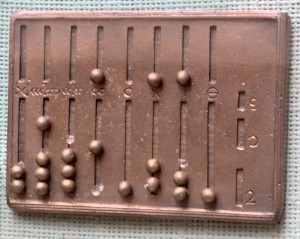
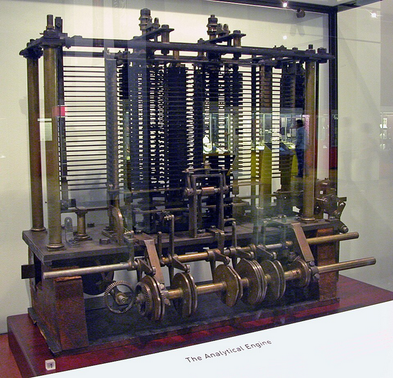
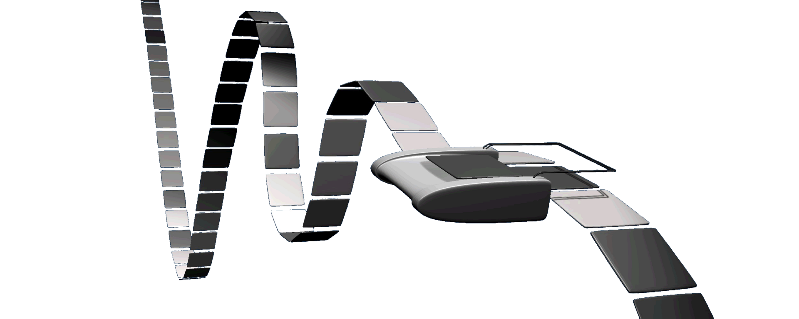
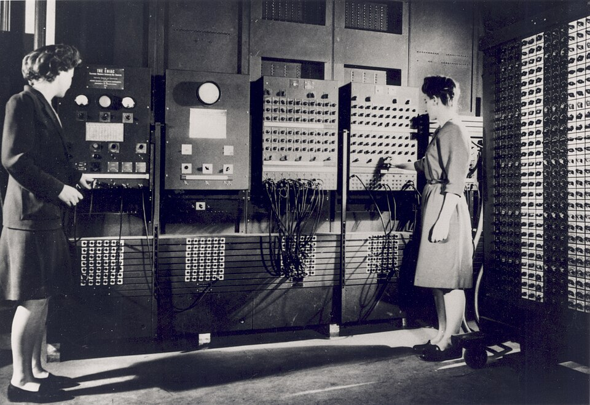
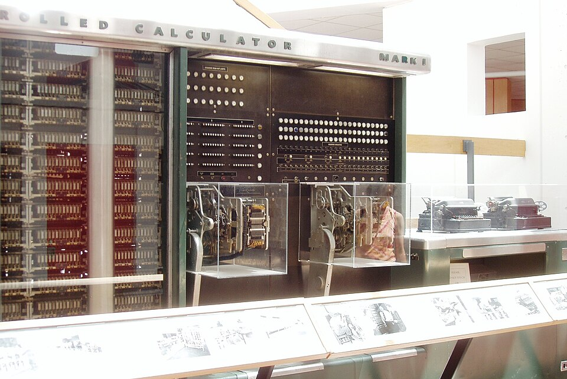

## Introdução

Ao longo da história humana, a necessidade de contar esteve presente na rotina da sociedade. Registrava-se o controle de rebanhos, o estoque de colheitas, o peso de metais e o volume de trocas comerciais. Para acelerar esses processos, surgiram os primeiros métodos manuais de auxílio ao cálculo, como o ábaco.

*Fonte: [Wikipedia](https://pt.wikipedia.org/wiki/%C3%81baco)*

No século XVII, a busca por automação deu início à era mecânica. Foi nesse período que surgiu a Pascalina, a primeira calculadora mecânica, capaz de realizar somas e subtrações por meio de um sistema de engrenagens.

A Pascalina foi projetada para realizar adição e subtração diretamente, efetuando a multiplicação e a divisão através da repetição dessas operações. Essa máquina introduziu o conceito mecânico de "vai um": ao ultrapassar o número 9 em um tambor, ele retornava ao zero e automaticamente adicionava uma unidade ao tambor imediatamente à sua esquerda, avançando para a próxima ordem de grandeza.

*Fonte: [Wikipedia](https://pt.wikipedia.org/wiki/Pascalina)*

Já no século XIX, a Máquina Analítica deu o salto definitivo ao introduzir o conceito de máquina programável, capaz de armazenar e processar dados autonomamente, criando a base conceitual que pavimentou o caminho para o surgimento dos computadores eletrônicos no século XX.

Projetada por Charles Babbage, a Máquina Analítica utilizava cartões perfurados para a entrada de instruções e dados. A arquitetura do sistema contava com uma unidade lógica e aritmética, controle de fluxo com desvios e uma memória dedicada ao armazenamento de informações. Embora nunca tenha sido concluída na época, tornou-se, conceitualmente, o primeiro projeto de um computador de uso geral Turing-completo.

*Fonte: [Wikipedia](https://pt.wikipedia.org/wiki/M%C3%A1quina_anal%C3%ADtica)*

## Teoria da Computação

### A Computação

O conceito de computar é mais amplo do que apenas calcular: é a realização de instruções através da manipulação de números, símbolos (letras), lógica (verdadeiro/falso) e condições (se/então), executadas por um algoritmo (sequência de passos). É essa definição mais ampla que fundamenta tudo o que viria a se tornar um computador moderno.

### Alan Turing e Turing-completo

Foi o matemático britânico Alan Turing quem deu a esse conceito uma base formal. Em 1936, Turing propôs um modelo teórico e abstrato de máquina, capaz de executar qualquer algoritmo computável através de um conjunto simples de regras. Esse modelo, conhecido como Máquina de Turing, não era um dispositivo físico — era uma ferramenta matemática criada para responder a uma pergunta fundamental: o que, exatamente, pode ser calculado?

A partir desse modelo teórico, nasceu o conceito de Turing-completo: diz-se que um sistema é Turing-completo quando é capaz, em teoria, de executar qualquer algoritmo que a Máquina de Turing seria capaz de executar, dado tempo e memória suficientes.

*Fonte: [Wikipedia](https://pt.wikipedia.org/wiki/M%C3%A1quina_de_Turing#/media/Ficheiro:Turing_Machine.png)*

### O Computador

Um computador, em sua essência, é uma máquina capaz de executar instruções que manipulam números, símbolos e lógica — aplicando na prática o conceito de computação apresentado anteriormente. Mas nem toda máquina desse tipo foi criada com o mesmo propósito: algumas nasceram para resolver um único problema específico, enquanto outras foram concebidas para resolver, em teoria, qualquer problema computável. Essa diferença separa os computadores em dois grandes grupos: especialistas e generalistas.

**Computador Especialista**

Um computador especialista é construído para executar uma única tarefa, de forma fixa, sem a capacidade de ser reprogramado para outra finalidade.

Um dos primeiros exemplos é a máquina tabuladora criada por Herman Hollerith em 1890, projetada exclusivamente para processar os dados do censo dos Estados Unidos através de cartões perfurados. A empresa fundada por Hollerith para comercializar sua invenção viria, anos depois, a se tornar a IBM.

Outro exemplo é o ABC (Atanasoff-Berry Computer), desenvolvido entre 1937 e 1942 por John Atanasoff e Clifford Berry, construído com o único objetivo de resolver sistemas de equações lineares. Assim como a máquina de Hollerith, o ABC não podia ser reprogramado para executar outro tipo de tarefa — por isso, apesar de sua importância histórica, nenhum dos dois se enquadra no conceito de computador Turing-completo.

**Computador Generalista**

Já um computador generalista é aquele capaz de ser reprogramado para executar diferentes tarefas, sem alterações em sua estrutura física — é essa flexibilidade que o torna, em teoria, Turing-completo.

O ENIAC, construído em 1945, é considerado um dos primeiros exemplos práticos desse conceito: diferente do ABC, ele podia ser reconfigurado para resolver diferentes tipos de cálculo, e não apenas um problema fixo. Essa capacidade de adaptação é o que, décadas depois, se tornaria o padrão de todo computador moderno.

*Fonte: [Wikipedia](https://pt.wikipedia.org/wiki/ENIAC#/media/Ficheiro:Two_women_operating_ENIAC_(full_resolution).jpg)*

### Mark I

*Fonte: [Wikipedia](https://en.wikipedia.org/wiki/Harvard_Mark_I#/media/File:Harvard_Mark_I_Computer_-_Right_Segment.JPG)*

## Era Eletrônica

Cada geração de computadores é contada em três pontos:

1. **A tecnologia que valida a mudança de geração** — o que tecnicamente marca a virada (válvulas → transistores → circuitos integrados → microprocessadores → IA/processamento paralelo).
2. **O computador de referência** — o principal exemplo daquela geração, com onde surgiu e quem o criou (mantendo o mesmo nível de profundidade — ou a falta dela — usado até aqui).
3. **As tecnologias que marcaram a geração** — o que surgiu e interagiu com aquele momento: internet, sistemas operacionais, e qualquer outra tecnologia relevante, tudo reunido neste mesmo bloco.

### Tabela mestra

| Geração | Tecnologia que Define a Mudança | Computador de Referência | Tecnologias que Marcaram a Geração |
|---|---|---|---|
| 1ª | Válvulas | ENIAC (1945) — EUA, criado por J. Presper Eckert e John Mauchly *(contexto da 2ª Guerra Mundial a detalhar)* | Nenhum sistema operacional; programação via cabos e cartões perfurados |
| 2ª | Transistores | IBM 1401 (1959) — IBM, EUA ⏳ *(confirmar nível de detalhe sobre criadores)* | Primeiros sistemas de processamento em lote (*batch*) |
| 3ª | Circuitos integrados | IBM System/360 (1964) — IBM, EUA ⏳ *(confirmar nível de detalhe sobre criadores)* | ARPANET (1969); multiprogramação / tempo compartilhado; nasce o Unix (1969) |
| 4ª | Microprocessadores | IBM PC (1981) — IBM, EUA ⏳ *(confirmar nível de detalhe sobre criadores)* | TCP/IP (1983) — nasce "a internet"; WWW e navegadores (1989–1993); HTML; MS-DOS, depois Windows e Mac OS; nasce o Linux (1991); ver linha do tempo detalhada abaixo |
| 5ª | IA / processamento paralelo | ⏳ *(pendente definir computador de referência, ou se esta geração não tem um marco único)* | Internet pós-Web (opcional: redes sociais, mobile, nuvem); sistemas operacionais móveis: Android e iOS |

### Linha do tempo — Internet e Navegadores (detalhe do item 3 da 4ª geração)

| Ano | Evento |
|---|---|
| 1970 | DARPA / ARPANET → Internet |
| 1993 | HTML e Navegadores |
| 1994 | Netscape |
| 1995 | Mocca → JavaScript, Internet Explorer (junto com Windows 95) |
| 2002 | Fim do Netscape, transformado no lançamento do Mozilla Firefox |
| 2008 | Google Chrome |
| 2010 | Import do V8 do Chrome para Node.js |